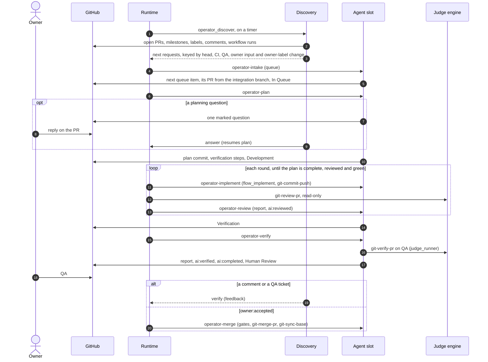

# Operator pack

Phase skills for the operator runtime (`@ainova-systems/operator`). The runtime is generic: it runs
the operations a project's `operator.yaml` declares, on timers and triggers, and holds pools, jobs
and waits. This pack is what those operations run. Each phase skill is a thin layer over the core
pack: it owns *when* a pull request moves and *who* holds it, and calls core and project skills for
the work - `dev-deliver`'s Phase A, profile `flow_implement`, `git-review-pr`, `git-verify-pr`,
`git-complete-pr`, `git-merge-pr`.

Without the runtime the same flow runs by hand, with neither `operator` nor herdr: profile
`operator_discover --standalone` names the next skill for each PR, and each skill runs from a
session (`operator-contract` > Run by hand). `dev-deliver-next` (core) delivers a queue item in one
session instead of phase by phase.

## Skills

| Skill | Milestone role (default title) | Leaves when |
|---|---|---|
| `operator-contract` | - | the run contract every phase skill loads first |
| `operator-intake` | the work queue → `queue` (In Queue) | a queue item has its pull request |
| `operator-plan` | `queue` (In Queue) | the plan and its verification steps are committed |
| `operator-implement` | `development` (Development) | the plan is complete, the head is reviewed and CI is green |
| `operator-review` | `development` (Development) | the runtime's review is posted (runtime only) |
| `operator-verify` | `verification` (Verification) | `git-verify-pr` passed and `git-complete-pr` wrote `ai:completed` |
| - (the owner) | `humanReview` (Human Review) | feedback returns it to Verification; `owner:accepted` sends it to merge |
| `operator-merge` | `mergeQueue` (Merge Queue) | merged |
| `operator-clarify` | a queue item waiting on an owner decision → `clarification` (Clarification) → `mergeQueue` → merged | the item is ready with every owner answer recorded |

## Profile keys

| Key | Meaning |
|---|---|
| `operator_config` | JSON with milestone and label names, owner author associations, `slots` (the agent slot names; a PR holds the slot its branch names from intake to merge or close), `clarifySlots` (slots that only clarify) and `clarifyCandidates` (how many ranked items discovery offers), `readyLimit` (ready PRs in QA at once), `verifySection`, the question marker and `pipelineMarkers` |
| `operator_discover` | The discovery command; `--standalone` prints the next skill per PR, `--request <n>` the request discovery makes for one PR now (a phase's hand-off), `--steps-digest <n>` the digest of a PR's verification steps, `--owner-input <n>` the last stage report and the owner input after it |
| `forge_cli` | The forge contract command every code-host call goes through: `pr` (list, view, create, ready, edit, body, files), `checks`, `threads`, `claim`, `factor`, `comment`, `notes`, `merge`, `events`, answering JSON. A platform's implementation is named `forge-<platform>` |
| `flow_queue` | The work queue's order and rules (core) |
| `flow_plan` | The skill that writes a feature-sized plan; none → the plan goes on the queue item |
| `flow_implement` | The implementation skill (core, `dev-deliver` Phase B) |
| `judge_runner` | How `git-review-pr` and `git-verify-pr` run: `none` in the session, or a skill that runs them in another engine |
| `qa_status` | How to read whether a QA deployment serves a head, and its address |
| `qa_feedback` | Command listing QA tickets for a PR; none → no tickets |
| `qa_feedback_status` | Command moving one QA ticket to in progress or completed with a comment for its submitter; none → tickets stay as the owner left them |
| `merge_gates` | Project rules that block a merge besides checks and factors |
| `clarify_priority` | The project's current business priority, which `operator-clarify` weighs among discovery's top candidates |
| `clarify_branch_prefix` | Branch prefix for a clarification pull request, which changes documents only |

## The flow

## Clarification

A queue item waiting on an owner decision is never picked by intake, so without help the most
important work waits longest. Discovery ranks those items (the owner's `clarifyFirst: true` first,
then `flow_queue` folder order, priority and how many items wait on each) and, whenever a
clarification slot is free, offers the top ones to `operator-clarify`. It picks one, plans the answer
from the repository first, then asks the owner one question at a time in a draft documentation pull
request, recording each answer in the documents. A settled item is ready; its `## Clarification - READY` report at the head is the authorization,
so the PR goes to Merge Queue and the same operation merges it once CI decides, without another
owner review. The PR body follows the skill's own short template (Task, Approach, Open questions). Clarification slots never take
delivery work, and delivery slots never clarify.

## What the owner does

- **Answers questions** in the PR conversation; discovery resumes the asking skill.
- **Tests on QA** in Human Review; a comment or a QA ticket sends the PR back.
- **Steers with labels**: `owner:accepted`, `owner:onhold`, `owner:revalidate`, `owner:rejected`,
  `owner:cancelled` (`operator-contract` > Owner labels); `owner:question` marks a pull request
  that waits on an owner's answer (`operator-contract` > Asking the owner).
