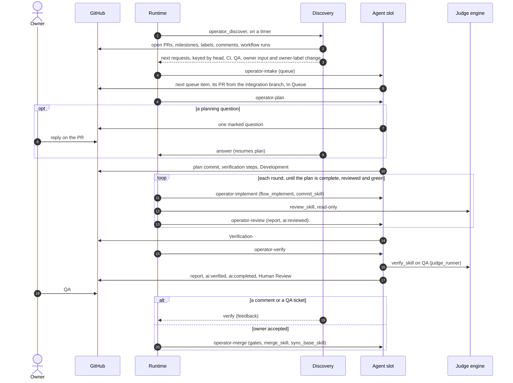

# Operator pack

Phase skills for the operator runtime (`@ainova-systems/operator`). The runtime is generic: it runs
the operations a project's `operator.yaml` declares, on timers and triggers, and holds pools, jobs
and waits. This pack is what those operations run. Each phase skill owns *when* a pull request
moves and *who* holds it, and hands the work of each step to the skill a profile key names
(`operator-contract` > Delegated steps): capturing criteria, committing, opening the pull request,
review, verification, review threads, the outcome, merging and returning a slot to the integration
branch, plus profile `flow_implement` for the implementation itself.

## Core: recommended, optional via profile keys

For a clean start install the core pack beside this one: every delegated-step key defaults to a
core skill, and core's `git-workflow` rule states the same label, factor and report vocabulary.
A project that already has its own equivalents points the keys at them instead. What a replacement
must honour is the contract the operator pack owns - the state labels and their single writer, the
success factors and their freshness at head (the verification steps digest included), the stage
report envelope and the claim (`operator-contract` > `references/pr-state.md`, which wins for operator
runs when both packs are installed) - and the duty each key's row in the Delegated steps table names.

Without the runtime the same flow runs by hand, with neither `operator` nor herdr (an optional
terminal multiplexer the runtime can place its runs in): profile
`operator_discover --standalone` names the next skill for each PR, and each skill runs from a
session (`operator-contract` > Run by hand). `dev-deliver-next` (core, when installed) delivers a
queue item in one session instead of phase by phase.

## Skills

| Skill | Milestone role (default title) | Leaves when |
|---|---|---|
| `operator-contract` | - | the run contract every phase skill loads first |
| `operator-intake` | the work queue, or a handed-off pull request → `queue` (In Queue) | a queue item has its pull request, or the handed-off one sits in a slot |
| `operator-plan` | `queue` (In Queue) | the plan and its verification steps are committed |
| `operator-implement` | `development` (Development) | the plan is complete, the head is reviewed and CI is green |
| `operator-review` | `development` (Development) | the runtime's review is posted (runtime only) |
| `operator-verify` | `verification` (Verification) | profile `verify_skill` passed and profile `outcome_skill` wrote `ai:completed` |
| - (the owner) | `humanReview` (Human Review) | feedback returns it to Verification; `owner:accepted` sends it to merge |
| `operator-merge` | `mergeQueue` (Merge Queue) | merged |
| `operator-clarify` | a queue item waiting on an owner decision → `clarification` (Clarification) → `mergeQueue` → merged | the item is ready with every owner answer recorded |

## Profile keys

| Key | Meaning |
|---|---|
| `operator_config` | The operator configuration JSON: milestone and label roles, owner author associations, slots, QA admission, CI workflows, markers and send-back routes. Schema: `operator-contract` > `references/operator-config.md`, example `references/operator-config.example.json` |
| `operator_discover` | The project's discovery command: `--standalone`, `--request <n>`, `--steps-digest <n>`, `--owner-input <n>`, and its runtime pass. Contract: `operator-contract` > `references/discovery-contract.md` |
| `forge_cli` | The forge contract command every code-host call goes through: `pr` (list, view, create, ready, draft, edit, body, files), `branch rename`, `checks`, `threads`, `claim`, `factor`, `comment`, `notes`, `merge`, `events`, answering JSON. On GitHub it points at `skills/operator-contract/scripts/forge-github.mjs` with `OPERATOR_CONFIG` naming `operator_config`; another platform ships its own implementation of the contract later |
| `flow_intake`, `commit_skill`, `open_pr_skill`, `review_skill`, `verify_skill`, `threads_skill`, `outcome_skill`, `merge_skill`, `sync_base_skill` | The skill each delegated step runs; unset = the core skill (`operator-contract` > Delegated steps lists the defaults, inputs, outputs and what a replacement must do) |
| `flow_queue` | The work queue's order and rules |
| `flow_plan` | The skill that writes a feature-sized plan; none → the plan goes on the queue item |
| `flow_implement` | The implementation skill: `auto` = the project's execution skill, else one subagent working to the plan's slices; or a skill name |
| `judge_runner` | How profiles `review_skill` and `verify_skill` run: `none` in the session, or a skill that runs them in another engine |
| `qa_status` | How to read whether a QA deployment serves a head, and its address |
| `qa_feedback` | Command listing QA tickets for a PR; none → no tickets |
| `qa_feedback_status` | Command moving one QA ticket to in progress or completed with a comment for its submitter; none → tickets stay as the owner left them |
| `merge_gates` | Project rules that block a merge besides checks and factors |
| `clarify_priority` | The project's current business priority, which `operator-clarify` weighs among discovery's top candidates |
| `clarify_branch_prefix` | Branch prefix for a clarification pull request, which changes documents only |

The skills also read these keys of the core profile; a project without core sets them in its own
profile, or the default applies:

| Key | Default | Read for |
|---|---|---|
| `integration_branch` | none (the default branch) | the base every pipeline branch starts from and returns to |
| `branch_prefixes` | `feature/, bugfix/, hotfix/` | the prefix of a pipeline branch, which also names its slot |
| `update_strategy` | `merge` | bringing the integration branch into a pull request's branch |
| `conflict_skill` | `git-resolve-conflicts` | resolving a conflict with the integration branch |
| `verify_section` | `Manual Verification` | the verification heading, and the section the steps digest covers |
| `pr_risk_size` | `off` | whether the body carries a Risk/Size line to recompute |
| `pr_success_factors` | `ai:verified, ai:reviewed` | the factors accept-ready requires fresh at head |
| `merge_method` | `squash` | how `merge_skill` merges |

## The flow

## Clarification

A queue item waiting on an owner decision is never picked by intake, so without help the most
important work waits longest. Discovery ranks those items (the owner's `clarifyFirst: true` first,
then `flow_queue` folder order, priority and how many items wait on each) and, whenever a
clarification slot is free, offers the top ones to `operator-clarify`. It picks one, plans the answer
from the repository first, then asks the owner one question at a time in a draft documentation pull
request, recording each answer in the documents. A settled item is ready; its `## Clarification - READY` report at the head is the authorization,
so the PR goes to Merge Queue and the same operation merges it once CI decides, without another
owner review. The PR body follows the skill's own short template (Task, Approach, Open questions). Clarification slots never take
delivery work, and delivery slots never clarify.

## What the owner does

- **Hands a pull request to the pipeline** with the `operator_config` `labels.handoff` label: the
  next free slot adopts it ahead of every queue item, plan revises its scope from what it already
  carries, and it follows the regular flow from there.
- **Answers questions** in the PR conversation; discovery resumes the asking skill.
- **Tests on QA** in Human Review; a comment or a QA ticket sends the PR back.
- **Steers with labels**: `owner:accepted`, `owner:onhold`, `owner:revalidate`, `owner:rejected`,
  `owner:cancelled` (`operator-contract` > Owner labels); `owner:question` marks a pull request
  that waits on an owner's answer (`operator-contract` > Asking the owner).
